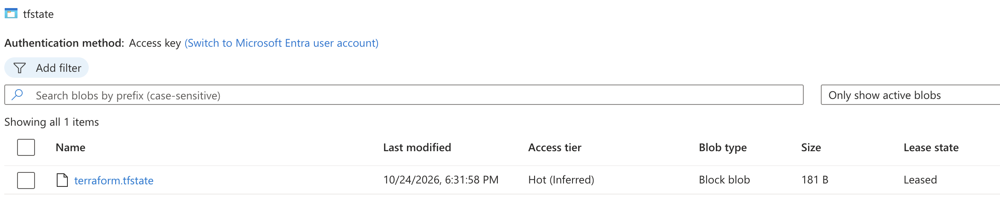
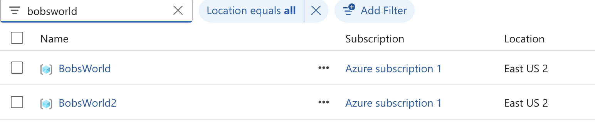
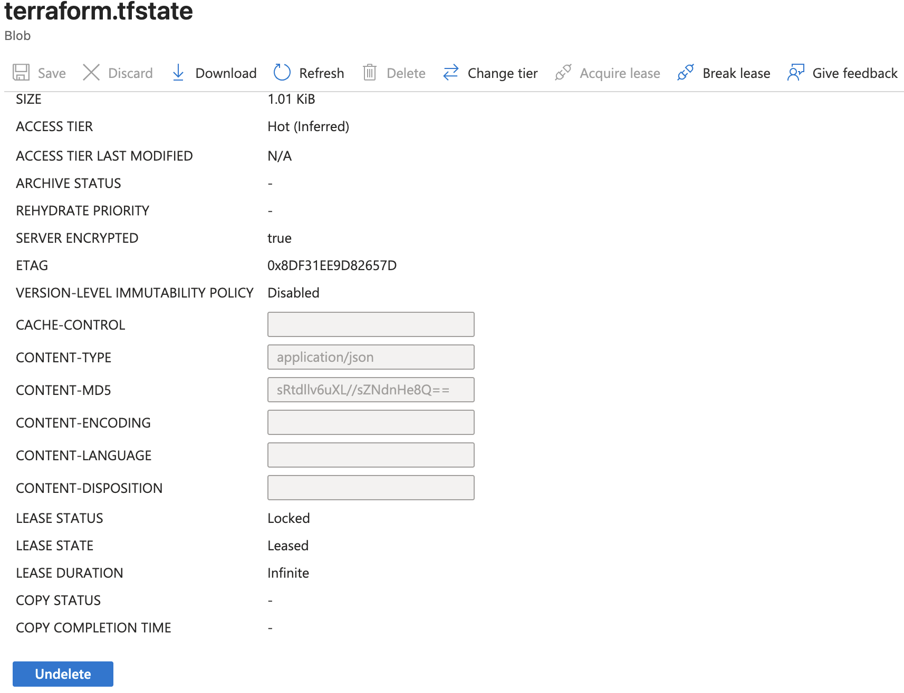

# terraform-jenkins-remote-backend

This is a follow on from a previous repo created.

One of the main issues with previous project is the inflexibility of the Statefile. For typical organizations we need to have central location for the Statefile so that different teams and developers can reference it when creating resources.

At the moment the Statefile is being stored on the Jenkins server itself. This is fine for small personal projects but quickly becomes problematic when the project or organization infrastructure needs grows.

One solution recommended is to store the Statefile in a remote backend, in this project I will be using an Azure storage account for this. 

Once this remote backend is completed I will create additional resources to demonstrate referencing this backend Statefile.

## Prerequisites

- Existing Jenkins pipeline configured to use the included Jenkinsfile.
- Access key of Storage account with container manually created in Azure to store backend Statefile.

## Procedure

### Setting up backend and testing
First, I will add the backend section in the main.tf, this is referencing my pre-configured storage accounts details:
```
 backend "azurerm" {
    resource_group_name  = "terraformstaterg01"
    storage_account_name = "terrafromstatestorage"
    container_name       = "tfstate"
    key                  = "terraform.tfstate" #This is the name of the actual Statefile, not the access key
  }
```

Using the Access Key copied from the created Storage account, I added a credential into my Jenkins instance.
I can then reference and assign to the required variable using the newly added:
```
 ARM_ACCESS_KEY = credentials('terraform-jenkins-remote-backend-key')
```

After running I can see it is successfully creating the resources, however I do not see a Statefile in my Storage account. Looking through the build logs I can see the following:
```
Acquiring state lock. This may take a few moments...
Do you want to copy existing state to the new backend?
  Pre-existing state was found while migrating the previous "local" backend to the
  newly configured "azurerm" backend. No existing state was found in the newly
  configured "azurerm" backend. Do you want to copy this state to the new "azurerm"
  backend? Enter "yes" to copy and "no" to start with an empty state.
```
As I have already deleted the resources created in the last repo manually (a practice that should be avoided in production), I have no use for the existing Statefile so I went ahead and just deleted it.
```
rm -fr /var/lib/jenkins/workspace/terraform-jenkins-remote-backend/terraform.tfstate
```
Now when we run the build again I can see a Statefile has been created:


### Adding additional resources

Now that the backend is configured lets add an additional resource group:
```
resource "azurerm_resource_group" "BobsWorld2" {
  name     = "BobsWorld2"
  location = "eastus2"

  tags = {
    owner = "JenkinsPipeline"
  }
}
```
I can confirm this is now configured:


Something to quickly note is as the pipeline runs I can see that the Statefile is in the "locked" status.

This is one of the advantages of using a backend Statefile. It means that the Statefile is only accessible at one time, reducing the likely hood of duplicate resources or corruption of resources.

## Conclusion
As per the initial requirements all parts have been configured. However there some things to consider changing or improving.
-   Method of storing Storage account access key - Storing the key in Jenkins is fine for this project, however as Jenkins instances grow a better solution would be to store in an Azure Keyvault. The benefit of this would be security, a compromised key would need to be rotated, meaning the need to replace it in each instance. If instead, I was  referencing a Keyvault, I can just change the single secret within the Keyvault.
-   Triggering resource creation - Manually triggering a build each time in Jenkins can be a little tedious, it would be better to implement a webhook that triggers a build each time a change is made to the main.tf. 
-   General complexity of the Terraform files and resources is quite low, this will be increased with each additional project.
-   The same "Groovy String interpolation" warning is appearing as in my last project, so I will review this moving forward.